<p>
  <picture>
    <source media="(prefers-color-scheme: dark)" srcset="assets/brand/logo-on-dark.svg">
    
  </picture>
</p>

Turns the treatment plan a dentist has already written into a clear, narrated explanation the patient can follow.

[](https://github.com/arminkhaleghirod/DentalClarity/actions/workflows/ci.yml)
[](LICENSE)
[](https://www.rust-lang.org)
[](https://dentalclarity-demo.fly.dev)

### [Try the live demo](https://dentalclarity-demo.fly.dev)

The demo uses a fictional practice with made-up patients. No sign-in is needed.

<a href="https://dentalclarity-demo.fly.dev">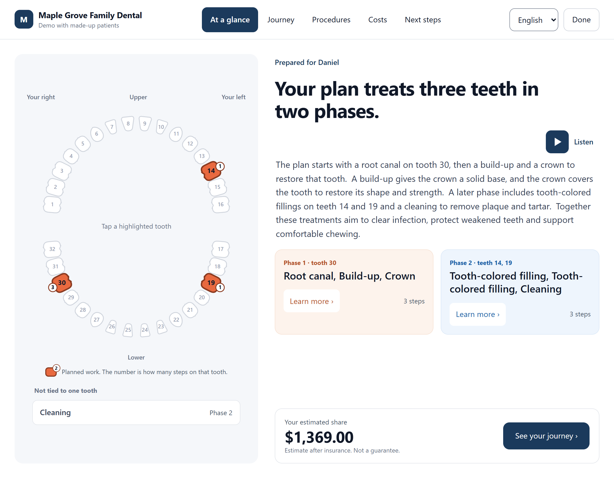</a>

DentalClarity reads the plan from the practice management system and turns it into a presentation: which teeth are involved, what each procedure is, how the phases fit together, what it is estimated to cost, and what happens next. Each explanation can be read aloud.

It explains the plan. It does not diagnose, recommend treatment, or try to persuade anyone to accept it.

DentalClarity is an early prototype built for the Teens in AI Global Challenge 2027. It is not for use with real patient data. See [Clinical use](#clinical-use).

## Why DentalClarity

A treatment plan is written for the dental team. It lists procedure codes, tooth numbers, phases and fees. Patients are often asked to agree to it after a short chairside conversation, and many leave unsure what a build-up is, why a crown follows a root canal, or which part of the cost is theirs.

Explaining every plan carefully, in the patient's language and at a reading level that suits them, takes time a practice rarely has. DentalClarity prepares that explanation from the plan the dentist already saved, so staff can hand the patient a tablet instead of writing anything new. The facts stay exactly as the practice recorded them, and the explanation stays within what the plan, the clinical note and a curated knowledge base support.

## How it works

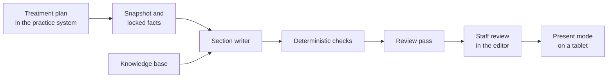

1. A staff member picks a patient and a plan. The server takes a read-only snapshot of the plan: procedures, codes, teeth, surfaces, phases and fees.
2. Each procedure code is mapped to a category in the knowledge base, a set of plain-language passages with cited sources.
3. A language model writes each section (at a glance, journey, one per procedure, next steps) from the locked facts, the matching knowledge passages and a sanitized excerpt of the linked clinical note. Every sentence names its source.
4. Deterministic validators check the output: schema, references, cited sources, tooth numbers, codes, timing, costs, and wording that would diagnose, promise outcomes, pressure the patient or give medication advice.
5. A second model call reviews each section against the same facts and sources. A section is repaired up to twice. One that still fails a deterministic check is marked failed, and one with an open safety finding from the review is held for staff.
6. Staff review the result in the editor. Text derived from the clinical note stays hidden from the patient until a staff member confirms it.
7. Staff press Present and hand over the device. The patient browses the plan; the staff session stays locked on the server until they exit.

The costs screen is built from the snapshot alone, with no model call.

## What patients see

- At a glance: a tooth chart with the planned teeth highlighted, a short summary of the phases and the estimated patient share.
- Journey: the phases in treatment order, with how the steps fit together. Visits are scheduled by the dental team, so the app never states dates or visit counts.
- Procedures: for each procedure, the tooth and location, an educational illustration, what it is, why the dentist recommended it (once staff confirm it), what happens during the visit, recovery, and questions to ask.
- Costs: fees, insurance estimates and the patient share per phase and in total, labeled as estimates.
- Next steps, plus narration for every block of text, with the transcript always on screen.

The patient screens carry the practice's name and colors, not the DentalClarity brand. Reading levels, other languages, questions and a take-home booklet are planned; see the [implementation plan](docs/IMPLEMENTATION.md).

## What staff see

- A dashboard of today's patients with an open treatment plan and the state of each presentation.
- A patient directory and a read-only view of each plan.
- A progress view while sections are written, checked and reviewed.
- An editor that shows, per section, where each block came from (written and checked, derived from the clinical note, or built from the plan), which checks passed, the model and prompt version used, and controls to edit, revert or confirm text.
- For a held section, controls to write it again or, once its text passes every deterministic check, to release it to the patient after a staff confirmation.

## Safety by design

- Procedures, teeth, phases and costs come from the practice's records. They are passed to the model as locked facts and the model never writes them.
- Every generated sentence cites a plan fact, a knowledge base passage or the linked clinical note, and the citation is checked.
- 17 deterministic validators run on every section. Any blocking issue sends the section to repair, and a section that still fails is held.
- A separate review call checks faithfulness, scope, balance, certainty and clarity. A reviewer pass can never override a deterministic failure, and it is never presented as clinician approval.
- Explanations taken from the clinical note are held until staff confirm them. Until then the patient sees the knowledge base's general wording.
- Held or failed sections are never shown to the patient. Their place shows a neutral note instead. Staff can release a held section only when its text, including their own edits, passes every deterministic check.
- Demo mode uses OpenRouter with synthetic data only. Clinical mode is designed to use the practice's own AWS account and never constructs the OpenRouter adapter.
- Only an allowlisted set of fields can reach a model. Names, patient numbers, dates, contact details, insurance identifiers and money values stay on the server and are filled in locally after validation.

The full rules are in [docs/AI_PIPELINE.md](docs/AI_PIPELINE.md) and [docs/SECURITY.md](docs/SECURITY.md).

## Evaluation

ClarityEval is the benchmark that measures how well current models do the jobs DentalClarity gives them: explaining an existing plan without changing its facts, staying within scope, refusing out-of-scope requests, keeping meaning across reading levels and languages, producing valid structured output, and doing so at a known cost and latency. Its results set the app's default models.

Cases are synthetic. The dev split in `eval/cases/dev/` is public and used for prompt tuning. The held-out split is kept out of the repository until the final runs; its salted hash commitment is published in [eval/commitments/heldout-v1.txt](eval/commitments/heldout-v1.txt) so anyone can check later that the cases were not changed.

<picture>
  <source media="(prefers-color-scheme: dark)" srcset="docs/clarityeval-score-dark.svg">
  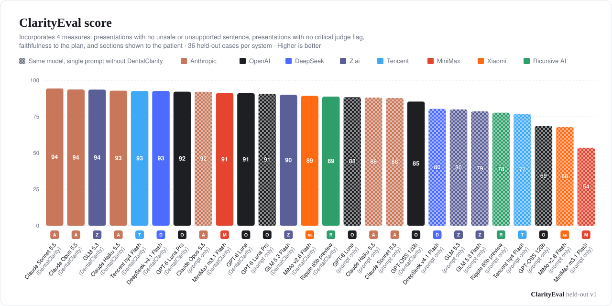
</picture>

The ClarityEval score combines four measures from the final held-out run; [DECISIONS.md](docs/DECISIONS.md) E22 defines it. Full results, with intervals for each measure, are in [docs/RESULTS.md](docs/RESULTS.md).

The method is described in [docs/CLARITYEVAL.md](docs/CLARITYEVAL.md).

## Screenshots

<table>
  <tr>
    <td width="50%">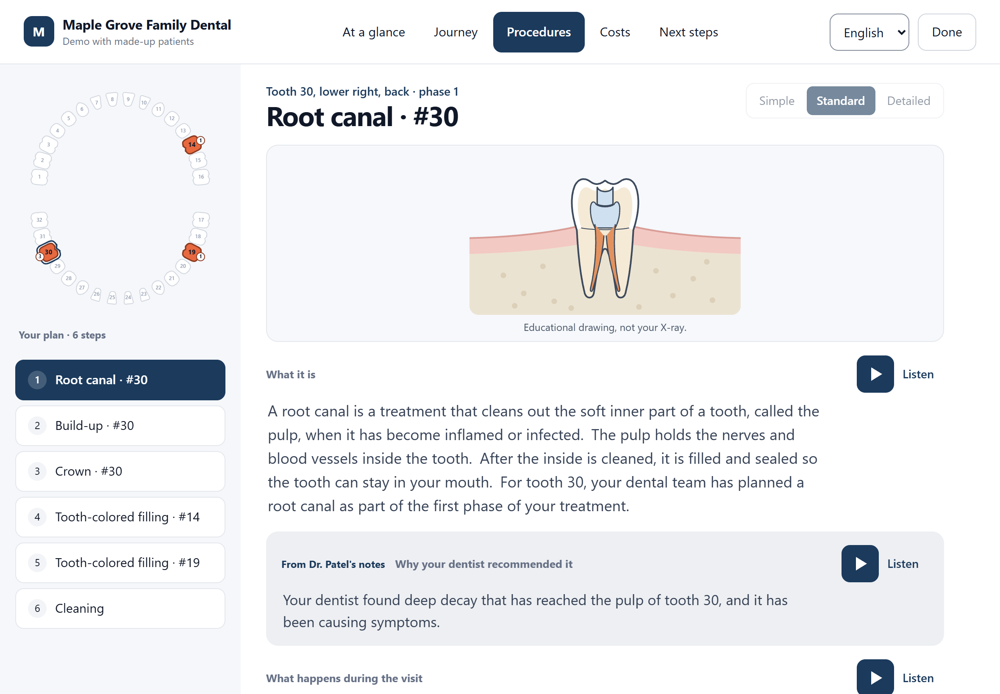</td>
    <td width="50%">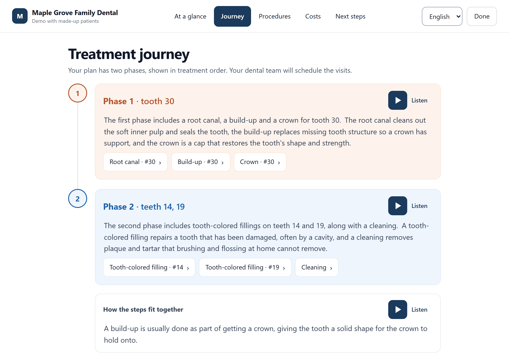</td>
  </tr>
  <tr>
    <td>Procedure detail with an educational illustration and narration</td>
    <td>Treatment journey in phase order</td>
  </tr>
  <tr>
    <td>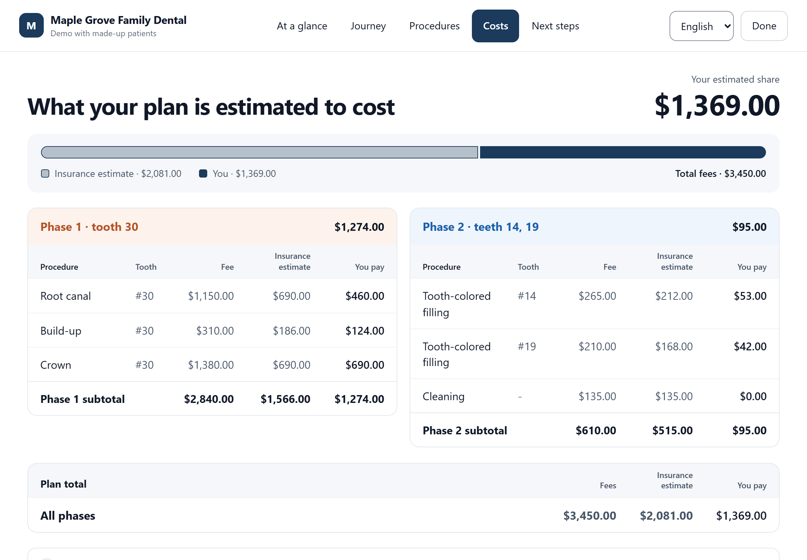</td>
    <td>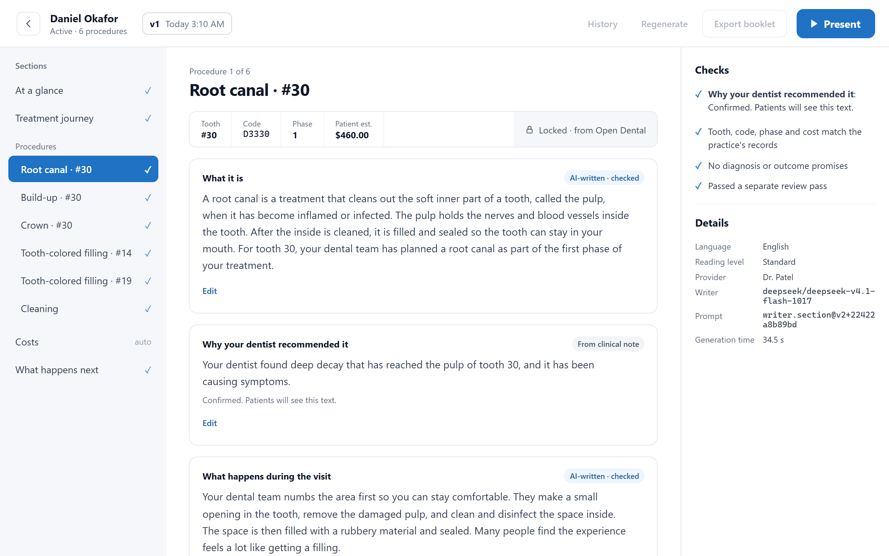</td>
  </tr>
  <tr>
    <td>Estimated costs, built from the plan with no model call</td>
    <td>Staff editor with provenance labels and checks</td>
  </tr>
  <tr>
    <td>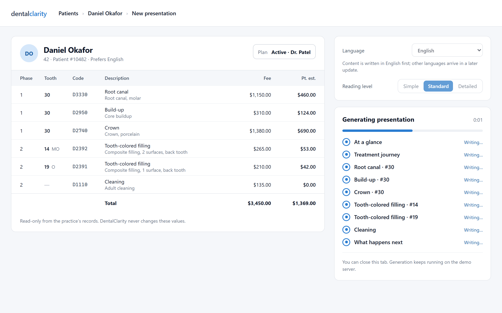</td>
    <td>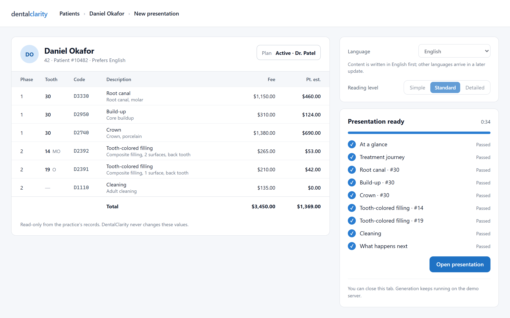</td>
  </tr>
  <tr>
    <td>Sections being written and checked</td>
    <td>Every section passed its checks and review</td>
  </tr>
  <tr>
    <td>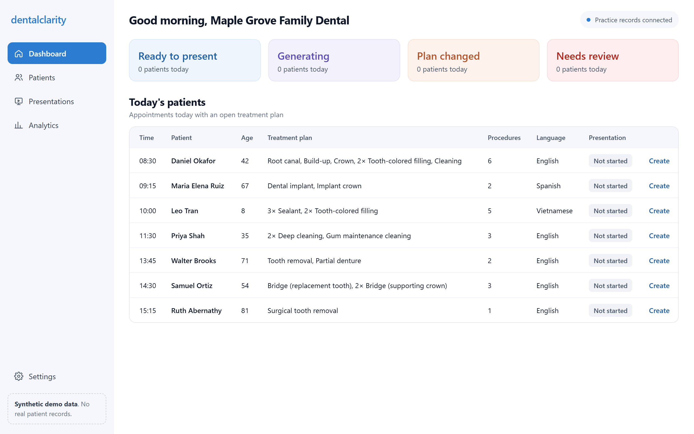</td>
    <td>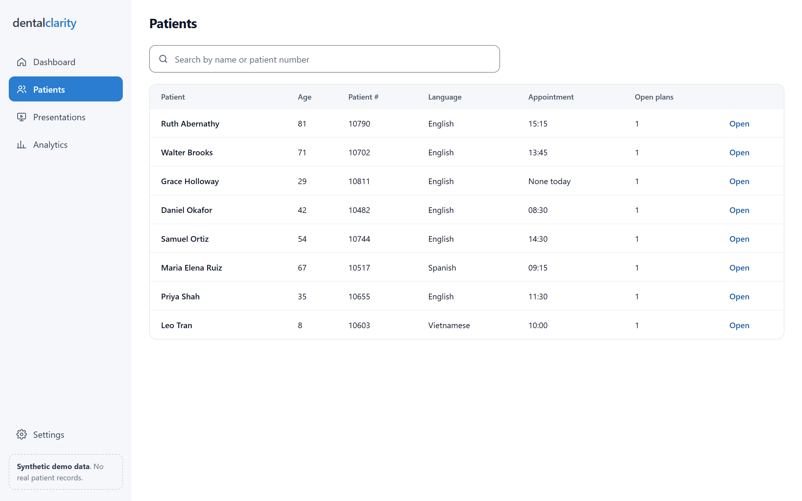</td>
  </tr>
  <tr>
    <td>Staff dashboard</td>
    <td>Patient directory</td>
  </tr>
</table>

The screenshots come from a local demo server and can be regenerated with [scripts/screenshots/capture.mjs](scripts/screenshots/capture.mjs).

## Quick start

### Run locally

Requirements: Rust 1.88 or newer, the `wasm32-unknown-unknown` target and [Trunk](https://trunkrs.dev).

```sh
rustup target add wasm32-unknown-unknown
cargo install trunk --locked

# Build the web app, then run the server in demo mode.
cd crates/dc-web && trunk build --release && cd ../..
cargo run -p dc-server
```

Open http://127.0.0.1:8080. Configuration comes from environment variables or a `.env` file; see [`.env.example`](.env.example). Set `OPENROUTER_API_KEY` to generate new presentations. Without it the app runs and generation reports that the provider is not configured.

Demo mode needs no sign-in. To try clinical mode on your own machine, start the server with `DC_MODE=clinical`. On first start it prints a one-time setup code in the console; enter it on the setup screen to create the shared staff account.

For frontend work, run `cargo run -p dc-server` and `trunk serve` in `crates/dc-web`, then open http://127.0.0.1:8081. Trunk rebuilds on save and forwards API calls to the server.

Run the tests with `cargo test`.

### Run with Docker

```sh
docker build -f deploy/Dockerfile -t dentalclarity-demo .
docker volume create dentalclarity-data
docker run --rm -p 8080:8080 \
  -v dentalclarity-data:/data \
  -e DC_PUBLIC_ORIGIN=http://localhost:8080 \
  -e OPENROUTER_API_KEY \
  dentalclarity-demo
```

Open http://localhost:8080. The image is for demo mode only. [deploy/README.md](deploy/README.md) covers the environment variables, the budget guard and deploying to Fly.io.

### Modes

| | Demo | Clinical |
|---|---|---|
| Data | Synthetic practice only | Open Dental, read-only |
| AI provider | OpenRouter | The practice's own AWS account (Bedrock and Polly) |
| Intended for | The public demo and development | A practice network, once the gaps below are closed |

## Repository layout

| Path | Contents |
|---|---|
| `crates/dc-core` | Domain model and API types shared by server and web app |
| `crates/dc-pms` | Practice management system connectors (synthetic now, Open Dental next) |
| `crates/dc-knowledge` | Curated knowledge base and code lookup |
| `crates/dc-ai` | Model providers and the mode policy that decides which may run |
| `crates/dc-generation` | Generation pipeline and validators |
| `crates/dc-server` | Axum server and the `dentalclarity` binary |
| `crates/dc-web` | Leptos web app for staff and patients |
| `crates/clarityeval` | ClarityEval benchmark runner and scorers |
| `fixtures/synthetic` | A fictional practice used by the demo and tests |
| `knowledge` | Procedure code map and knowledge entries |
| `assets` | Logo, brand files and procedure illustrations |
| `eval` | ClarityEval dev cases and the held-out commitment |
| `deploy` | Dockerfile, entrypoint and Fly.io configuration for the demo; `deploy/windows` has the clinical installer |
| `scripts` | Helper scripts, such as the screenshot capture |
| `docs` | Product, architecture, AI pipeline, UI, security and evaluation plans |

## Documentation

- [Decision log](docs/DECISIONS.md)
- [Product requirements](docs/PRD.md)
- [Architecture](docs/ARCHITECTURE.md)
- [AI pipeline](docs/AI_PIPELINE.md)
- [UI specification](docs/UI_SPEC.md)
- [Security](docs/SECURITY.md)
- [ClarityEval benchmark](docs/CLARITYEVAL.md)
- [Implementation plan](docs/IMPLEMENTATION.md)
- [Deploying the demo](deploy/README.md)
- [Installing on Windows](deploy/windows/README.md)
- [Contributing](CONTRIBUTING.md)

## Clinical use

DentalClarity is a prototype. It has not been clinically validated. Open source and self-hosting do not make software HIPAA compliant, and neither does using a cloud service that is eligible under a business associate agreement.

Clinical mode runs on a Windows server in the practice: a Windows service, HTTPS on the LAN with the practice's certificate or a generated local CA, secrets protected with DPAPI, and Bedrock and Polly in the practice's own AWS account. Building and installing it is described in [deploy/windows/README.md](deploy/windows/README.md).

Before any practice uses it with real patient records, every gap in the [clinical-readiness checklist](docs/SECURITY.md#clinical-readiness-gap-checklist) must be closed, and the practice must complete its own security assessment:

| # | Gap | Needed before real patient data |
|---|---|---|
| G1 | One shared staff account | Individual accounts, unique user identification, a per-user audit trail |
| G2 | No roles | At least admin and staff roles, with settings and secrets limited to admin |
| G3 | The database is not encrypted by the app | An encrypted database, or a documented and verified full-disk encryption requirement |
| G4 | Backup encryption and restore | Encrypted backups and a tested restore procedure |
| G5 | Provider agreements | A signed AWS business associate agreement, confirmed service eligibility and region, documented data flows |
| G6 | AWS credential handling | Least-privilege IAM, and rotation or short-lived credentials |
| G7 | TLS on all clients | A trusted certificate on every workstation and tablet, with no click-through warnings |
| G8 | Audit log integrity | Append-only or hash-chained audit events, with retention set by the practice |
| G9 | Clinical content review | Every knowledge base entry and illustration reviewed by a dentist; all are unreviewed now |
| G10 | Open Dental semantics | Verification against the deployed Open Dental version, including how notes link to procedures |
| G11 | Note handling | Staff confirmation of every note-derived block, and clinician review of note-derived output |
| G12 | Retention | Retention periods approved by the practice and configured |
| G13 | Incident response | A documented contact, a breach-assessment procedure and access to logs |
| G14 | Independent review | An external security review or penetration test of the clinical build |
| G15 | Windows hardening | The service account, data folder permissions and firewall rule verified on the practice's server, and a code-signed installer |

## Credits and attribution

Models, used in demo mode through [OpenRouter](https://openrouter.ai):

- `deepseek/deepseek-v4.1-flash-1017` writes and reviews the text. ClarityEval may replace it, and a reviewer from a different model family is preferred.
- `heygen/heygen-voice-1-turbo` produces the narration.

The server is built on [Axum](https://github.com/tokio-rs/axum), [Tokio](https://tokio.rs), [SQLx](https://github.com/launchbadge/sqlx) with SQLite, [reqwest](https://github.com/seanmonstar/reqwest), [Serde](https://serde.rs), [tracing](https://github.com/tokio-rs/tracing), [rust-embed](https://github.com/pyrossh/rust-embed) and [Argon2](https://github.com/RustCrypto/password-hashes). The web app uses [Leptos](https://leptos.dev) and [gloo](https://github.com/rustwasm/gloo), built with [Trunk](https://trunkrs.dev). The full dependency list with versions is in [Cargo.lock](Cargo.lock).

Knowledge base passages are written for this project, and each entry in [knowledge/entries](knowledge/entries) cites the published sources it draws on. The procedure illustrations and the logo are original work made for DentalClarity. All patient data in the repository and the demo is synthetic.

## How this was built

Built with Claude Code as a coding assistant for code generation, refactoring, tests and documentation drafts. Product scope, clinical boundaries, design direction and evaluation design are the author's.

## License

Apache License 2.0. See [LICENSE](LICENSE).

CDT procedure codes are referenced by number only. CDT descriptors are copyrighted by the American Dental Association and are not included in this repository.
